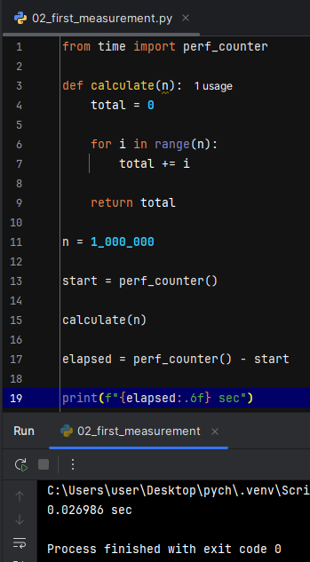
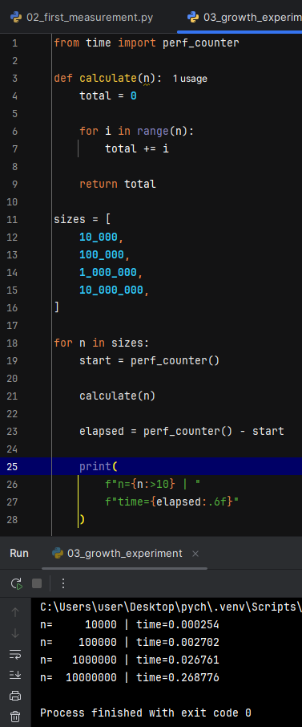
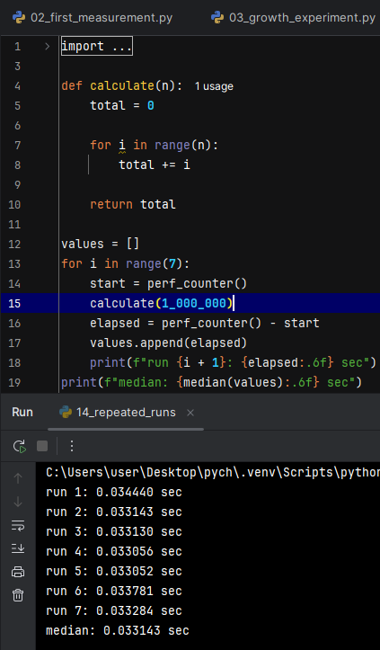
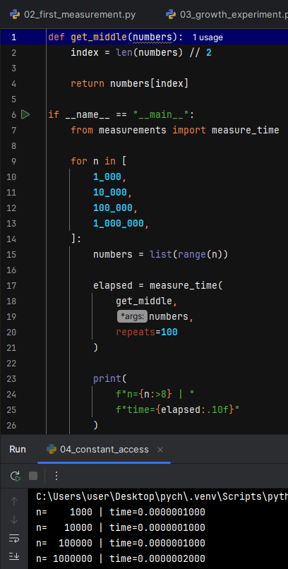
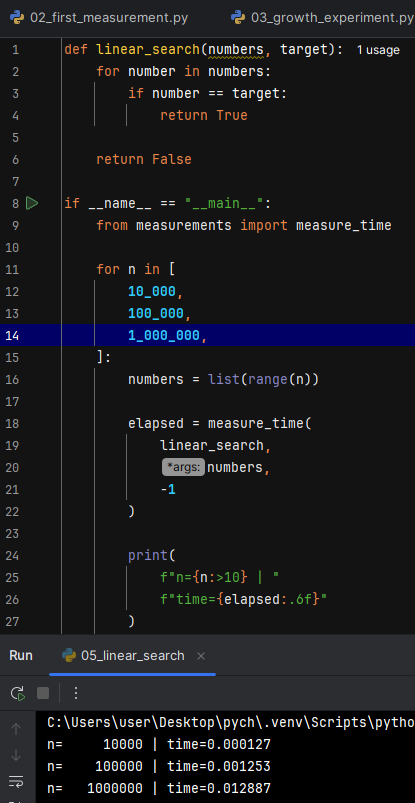
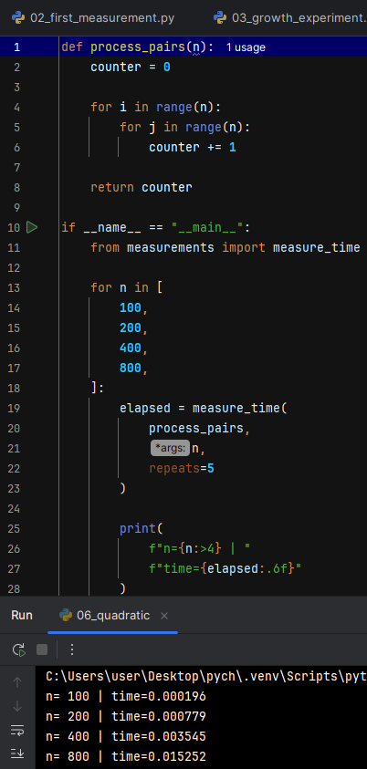
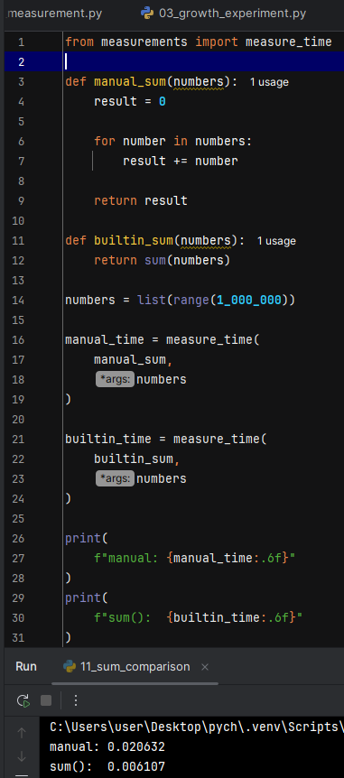
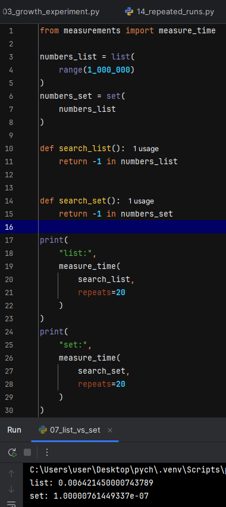
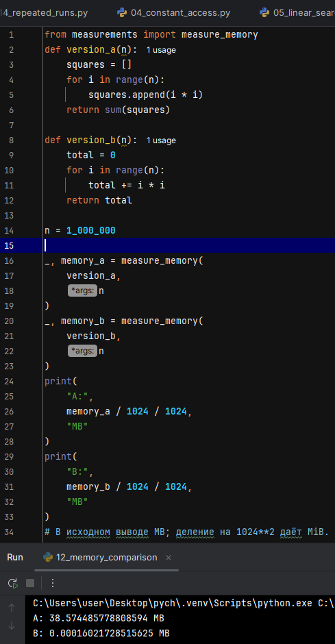
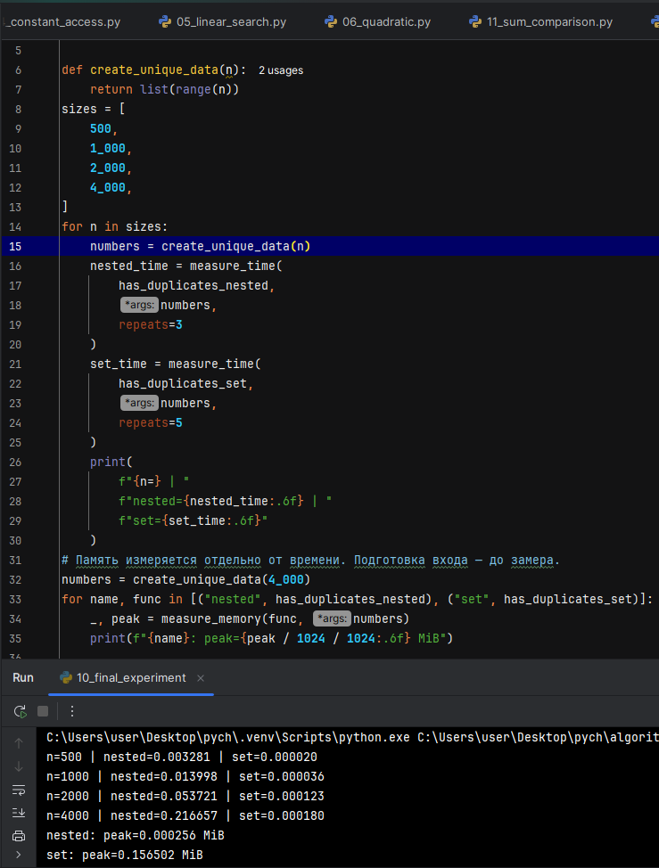

# Домашнее задание № 3 · Замеры времени выполнения и использования памяти

**Студент:**  Утеева Алиса Андреевна
**Группа:**  РПО 11/2

Срок — до начала занятия 5.

## Что сделать

1. Изучить презентацию занятия.
2. Скачать архив с программами и запустить у себя примеры из презентации.
3. Сделать скриншоты: на каждом видно код, результат запуска и полученное
   время или память.
4. Для каждого примера заполнить раздел ниже: скриншот, что измерялось,
   результат и вывод в 1–3 предложения.
5. Загрузить работу в эту папку и прислать ссылку на неё.

ИИ можно использовать, чтобы объяснить результат, сформулировать вывод или
разобрать непонятный код. Программы запускаете сами.

Запуск: `python3 02_first_measurement.py`, на Windows `py`. Архив распакуйте
целиком. Файлы `01`, `08` и `09` ничего не печатают — их запускать не нужно.

**Компьютер и версия Python:**
Компьютер: Windows 10
Версия Python: PyCharm 2025.1.1.1
Build #PY-251.25410.159, built on May 14, 2025
Source revision: 31f194c2a1782
Runtime version: 21.0.6+9-b895.109 amd64 (JCEF 122.1.9)
VM: OpenJDK 64-Bit Server VM by JetBrains s.r.o.
Toolkit: sun.awt.windows.WToolkit
Windows 10.0
GC: G1 Young Generation, G1 Concurrent GC, G1 Old Generation
Memory: 2048M
Cores: 12
Registry:
  ide.experimental.ui=true
Non-Bundled Plugins:
  com.intellij.plugins.vscodekeymap (251.23774.318)
---

## Пример 1. `02_first_measurement.py`

**Скриншот:**   

**Что измерялось:**  Время выполнения функции calculate(n) при n = 1 000 000.
**Результат:**  0.026986 sec
**Вывод:**  Измерение подтверждает линейную зависимость времени выполнения от n. Сложность алгоритма соответствует O(n).

## Пример 2. `03_growth_experiment.py`

**Скриншот:**  

**Что измерялось:**  Время выполнения calculate(n) для n = 10 000, 100 000, 1 000 000, 10 000 000.
**Результат:**  0.000254, 0.002702, 0.026761, 0.268776.
**Вывод:**  При увеличении n в 10 раз время выполнения растёт примерно в 10 раз. Это подтверждает линейную сложность O(n).

## Пример 3. `14_repeated_runs.py`

**Скриншот:**   

**Что измерялось:**  Время одной и той же операции в 7 последовательных запусках.
**Результат:**  run 1: 0.034440 sec
run 2: 0.033143 sec
run 3: 0.033130 sec
run 4: 0.033056 sec
run 5: 0.033052 sec
run 6: 0.033781 sec
run 7: 0.033284 sec
median: 0.033143 sec
**Вывод:**  Время отдельных запусков отличается из-за влияния других процессов. Медиана является более устойчивой характеристикой измерений, чем среднее значение; данный эксперимент оценивает стабильность замеров, а не класс сложности алгоритма.

## Пример 4. `04_constant_access.py`

**Скриншот:**   

**Что измерялось:**  Время доступа к элементу списка по индексу (get_middle) при n = 1 000, 10 000, 100 000, 1 000 000.
**Результат:**  Время остаётся практически постоянным (~0.0000002 сек).
**Вывод:**  Время доступа практически не зависит от размера списка. Доступ к элементу по индексу имеет константную сложность O(1).

## Пример 5. `05_linear_search.py`

**Скриншот:**   

**Что измерялось:**  Время линейного поиска отсутствующего элемента -1 в списке при n = 10 000, 100 000, 1 000 000.
**Результат:**  0.000127, 0.001253, 0.012887 сек.
**Вывод:**  Время выполнения увеличивается примерно линейно с ростом n. Это соответствует сложности O(n).

## Пример 6. `06_quadratic.py`

**Скриншот:**  

**Что измерялось:**  Время обработки пар элементов (process_pairs) при n = 100, 200, 400, 800.
**Результат:**  0.000196, 0.000779, 0.003545, 0.015252.
**Вывод:**  При удвоении n время выполнения увеличивается примерно в 4 раза. Это подтверждает квадратичную сложность O(n²).

## Пример 7. `11_sum_comparison.py`

**Скриншот:**  

**Что измерялось:**  Время ручного суммирования (manual_sum) и встроенной функции sum() для списка из 1 000 000 чисел.
**Результат:**  manual = 0.020632 сек, sum() = 0.006107 сек.
**Вывод:**  Встроенная sum() работает быстрее ручного суммирования. При этом оба подхода имеют линейную сложность O(n).

## Пример 8. `07_list_vs_set.py`

**Скриншот:**  

**Что измерялось:**  Время поиска отсутствующего элемента -1 в list и set для 1 000 000 элементов.
**Результат:**  list: 0.006421450000743789 сек, set: 1.00000761449337e-07 сек.
**Вывод:**  Поиск в set значительно быстрее поиска в list. Для set подтверждается сложность O(1), а для линейного поиска в list — O(n). Создание set в замер не включалось.

## Пример 9. `12_memory_comparison.py`

**Скриншот:**  

**Что измерялось:**  Пиковое использование памяти для version_a (создаёт список квадратов) и version_b (без списка) при n = 1 000 000.
**Результат:**  version_a = 38.574485778808594 MiB, version_b = 0.00016021728515625 MiB.
**Вывод:**  version_a использует O(n) дополнительной памяти, тогда как version_b использует O(1) памяти. Эксперимент подтверждает теоретические оценки.

## Пример 10. `10_final_experiment.py`

**Скриншот:**  

**Что измерялось:**  Время и память при поиске дубликатов двумя способами (nested и set) для n = 500, 1000, 2000, 4000.
**Результат:**  время nested: 0.003281, 0.013998, 0.053721, 0.216657 сек; время set: 0.000020, 0.000036, 0.000123, 0.000180 сек; память: nested peak = 0.000256 MiB, set peak = 0.156502 MiB.
**Вывод:**  nested имеет сложность O(n²) по времени и O(1) по памяти, а set — O(n) по времени и O(n) по памяти. set значительно быстрее, но требует больше дополнительной памяти.
